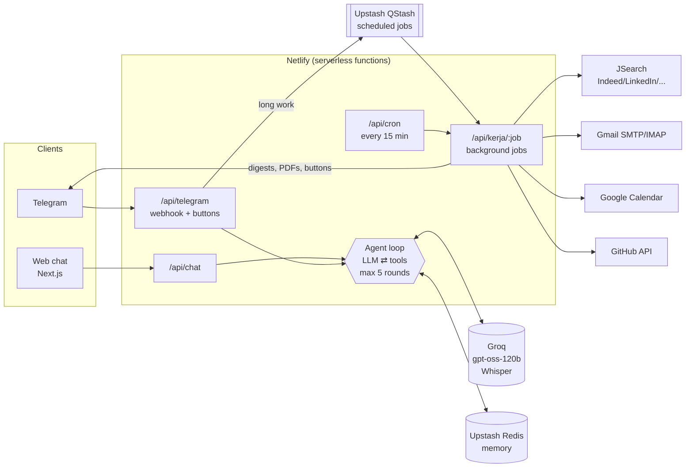

# Tanya Darwish: an agentic AI portfolio and personal career agent

[](https://github.com/darwish12345/tanya-darwish/actions/workflows/ci.yml)
[](https://github.com/darwish12345/tanya-darwish/actions/workflows/eval.yml)

**Live:** https://tanya-darwish.netlify.app · **Stats & eval score:** https://tanya-darwish.netlify.app/statistik

One agent core, two faces:

| | Public portfolio agent (web) | Personal agent (Telegram, owner only) |
|---|---|---|
| Who uses it | Recruiters, employers, friends | Darwish |
| What it does | Answers questions about my work **with evidence** (RAG), shows project cards, scores a pasted job description against my profile, books interviews on my calendar, passes messages to me as smart leads | Reminders (one-off and recurring, exact to the minute), tasks with deadline warnings, morning briefing, daily job search with match scoring, tailored ATS resume + cover letter, sends applications **only after I press "Send"**, watches my inbox for recruiter replies, voice notes, CV/LinkedIn PDF import |

> The code uses Malay identifiers (`peringatan` = reminder, `tugasan` = task, `kerja` = job, `permohonan` = application). The UI and agent answer in Malay or English, following the visitor.

## Architecture



**How one answer is produced** (`src/lib/agent/loop.ts`): the LLM receives the conversation plus tool definitions (zod schemas converted to JSON Schema) → it either answers or requests tools → the code validates the arguments and runs them → results go back to the LLM → repeat (max 5 rounds). If the model invents a tool name (Groq returns `400 tool_use_failed`), the loop tells it the valid names and retries; it recovers on its own.

## Engineering decisions

| Decision | Why |
|---|---|
| **Hand-written agent loop** instead of LangChain/LangGraph | ~150 lines I fully understand and can test with a mock LLM. Every step is visible (tool labels in the UI). |
| **Serverless + queue** (Netlify + QStash) instead of FastAPI + Celery + Redis worker | Zero idle cost, nothing to keep running. QStash calls back into `/api/kerja/:job` at an exact time (reminders) or fans out work (one job search per role, then scoring after 90 s) so no function hits a timeout. Jobs are idempotent: QStash and the cron backup can both fire without double-sending. |
| **Lexical RAG** (MiniSearch + Malay/English synonym map) instead of a vector DB | The corpus is small and factual. Keyword search with synonyms is deterministic, free, and handles "certifications" → `sijil`. Knowledge added via Telegram or synced from GitHub is searchable within 60 s. |
| **Anti-fabrication resume generation** | The LLM never writes resume bullets. It selects skills and bullet **indices** from the master resume; code validates every index and drops anything not in the master (`sahkanDraf`, tested). |
| **Human in the loop for anything irreversible** | Applications are emailed only from the Telegram "Send" button. Agent status messages are honest: `sent` / `saved` / `failed`. |
| **Dated instructions vs permanent preferences** | "Tomorrow skip LinkedIn" is stored for that date only; "from now on Indeed only" changes the preference. This came from a real bug where a one-day instruction became permanent; there is now a regression test and an eval case. |
| **Time is computed in code, not by the LLM** | "In 5 minutes" → the model passes `selepas_minit: 5`; code computes Malaysia time (UTC+8). Another real bug turned into a test. |

## Quality

- **Guardrails:** per-IP rate limit, input length limits, prompt-injection rules (tool results are data, not instructions), output sanitiser (zero-width characters, runaway repetition), owner-only Telegram, secret-token webhooks.
- **Tests (no network):** `npm test` runs the web agent, personal agent and career pipeline against a fake Telegram server, a fake JSearch server and a scripted LLM. They include regression tests for each bug found in real use.
- **Evals (real LLM):** `evals/kes.json` holds 56 cases across facts, honesty/anti-fabrication, language, security, off-topic, leads, job-match, booking, reminders, tasks and dated instructions. Checks cover which tools were called, regexes on the answer, reply language, and **the resulting state** (e.g. was the reminder stored for exactly 07:00 tomorrow?). They run in GitHub Actions and the score is shown on [/statistik](https://tanya-darwish.netlify.app/statistik). Latest report: [`evals/laporan-terkini.md`](evals/laporan-terkini.md).
- **CI:** lint, typecheck, tests and build on every push.

## Cost: RM0 / month

| Service | Free tier used |
|---|---|
| Netlify | Hosting + functions (Free plan, hard credit cap, no card) |
| Groq | gpt-oss-120b: 30 req/min, 8K tokens/min, 200K tokens/day; Whisper for voice notes |
| Upstash Redis | 500K commands/month |
| Upstash QStash | Free daily message quota (≈ 5–20 used per day) |
| JSearch (RapidAPI Basic) | 200 requests/month (≈ 90 used by the daily search) |
| Gmail, Google Calendar, GitHub API, Telegram Bot API, GitHub Actions | Free |

## Project structure

```
src/
  app/
    api/chat/            web agent endpoint
    api/telegram/        Telegram webhook: text, voice, PDF, buttons
    api/kerja/[nama]/    background jobs called by QStash
    api/cron/            15-minute scheduler (briefing, job search, report, inbox, GitHub)
    api/statistik/       public, anonymous usage stats
    statistik/           stats page
  lib/
    agent/               loop, prompts, web tools, personal tools + router
    kerjaya/             JSearch client, match scoring, application tracker, PDF resume, approval flow
    rag/knowledge.ts     search over content/ + knowledge added via Telegram + GitHub repos
    peringatan.ts        reminders (recurring, idempotent delivery, snooze)
    kerja.ts             job registry + scheduler
content/                 profile, certificates, FAQ, projects, master resume (public facts only)
evals/                   eval cases and latest results
scripts/                 tests, eval runner, local CLI chat
```

## Run locally

```bash
npm install
cp .env.example .env.local   # at minimum: GROQ_API_KEY
npm run dev                  # http://localhost:3000
npm test                     # offline tests
npm run eval                 # real-LLM evals (needs GROQ_API_KEY)
```

Without Upstash the app stores data in `.data/`. Every optional integration (Telegram, QStash, JSearch, Gmail, Calendar) switches off cleanly when its keys are missing, and `/api/sihat` shows what is configured. Full setup steps (in Malay): [`docs/SETUP.md`](docs/SETUP.md).

## Author

Muhammad Darwish · Software Engineering intern · [GitHub](https://github.com/darwish12345) · [Live agent](https://tanya-darwish.netlify.app)
